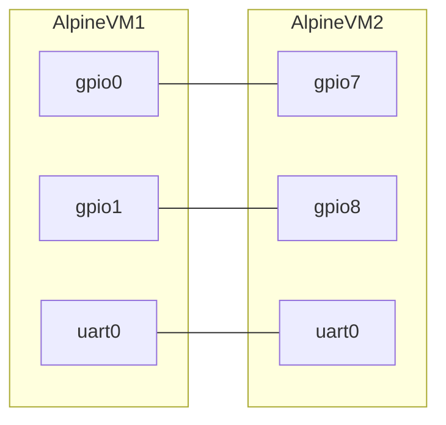

# Running VMs

In this guide, we will learn to set up and run an [Alpine
Linux](https://alpinelinux.org/) virtual machine inside NEST.

## Installing Alpine

Start by downloading the latest [Alpine Linux installation
image](https://alpinelinux.org/downloads/) ISO for your desired
architecture[^1]. This guide uses the [standard x86_64
image](https://dl-cdn.alpinelinux.org/alpine/v3.24/releases/x86_64/alpine-standard-3.24.2-x86_64.iso)
(version 3.24). While downloading the image, create a QCOW2 virtual disk with
enough capacity to install Alpine:

[^1]: To benefit from hardware-accelerated CPU virtualization (e.g. via
    [KVM](https://linux-kvm.org/page/Main_Page)), make sure to match your
    host machine's architecture.

```bash
qemu-img create -f qcow2 alpine.qcow2 8G # (1)!
```

1. You can replace 8G with your desired disk size.

??? info "About QCOW2"

    QCOW2 is QEMU's versatile Copy-On-Write virtual disk format. It natively
    uses dynamic allocation, which means that the supporting `.qcow2` file only
    grows as actual data is being written to it. For example, if only 4GB of a
    32GB QCOW2 disk are currently used, then the supporting `.qcow2` file will
    only be 4GB in size. Another useful feature of QCOW2 is snapshots, which
    enable capturing disk state and reverting it to earlier states for recovery
    and reproducibility.

Once the installation image downloaded, boot a QEMU virtual machine from the
ISO with the QCOW2 virtual disk attached. Use the QEMU system command matching
the architecture you chose (e.g. `qemu-system-aarch64` for a 64-bit ARM ISO).

```bash
qemu-system-x86_64 \
    -m 512 \ # (1)!
    -nic user \ # (2)!
    -boot once=d \ # (3)!
    -cdrom alpine-standard-3.24.1-x86_64.iso \ # (4)!
    -drive file=alpine.qcow2 \ # (5)!
    -nographic \ # (6)!
    -enable-kvm # (7)!
```

1. The amount of RAM of the VM (in MiB).
2. Forwards the host machine's NIC to the VM (required for internet access
   during installation).
3. Tells the VM to boot from the CD-ROM drive on first startup (containing the
   installation ISO), and then automatically switch back to the default boot
   order (hard drive) on subsequent reboots.
4. The ISO to mount as a CD-ROM drive.
5. The QCOW2 file to mount as a hard drive.
6. Disables graphical output and redirects the emulated serial port to the console.
7. Enable KVM for hardware acceleration (optional).

Login with `root` (no password), then enter setup:

```bash
setup-alpine
```

Configure the system to your liking. In the "Disk & Install" section, select
the QCOW2 disk (e.g. `sda`) and use it as `sys`. See below for the exact
configuration used in this guide.

??? example "Setup transcript for this guide"

    !!! info

        Non-default options highlighted.

    ```bash hl_lines="71 96 101 106"
     ALPINE LINUX INSTALL
    ----------------------

     Hostname
    ----------
    Enter system hostname (fully qualified form, e.g. 'foo.example.org') [localhost] 

     Interface
    -----------
    Available interfaces are: eth0.
    Enter '?' for help on bridges, bonding and vlans.
    Which one do you want to initialize? (or '?' or 'done') [eth0] 
    IPv4 address for eth0? (or 'dhcp', 'none', '?') [dhcp] 
    IPv6 address for eth0? (or 'auto', 'dhcp', 'none', '?') [auto] 
    Do you want to do any manual network configuration? (y/n) [n] 
    udhcpc: started, v1.37.0
    udhcpc: broadcasting discover
    udhcpc: broadcasting select for 10.0.2.15, server 10.0.2.2
    udhcpc: lease of 10.0.2.15 obtained from 10.0.2.2, lease time 86400

     Root Password
    ---------------
    Changing password for root
    New password: # (1)!
    Bad password: too short
    Retype password: 
    passwd: password for root changed by root

     Timezone
    ----------
    Africa/            Egypt              Iran               Poland
    America/           Eire               Israel             Portugal
    Antarctica/        Etc/               Jamaica            ROC
    Arctic/            Europe/            Japan              ROK
    Asia/              Factory            Kwajalein          Singapore
    Atlantic/          GB                 Libya              Turkey
    Australia/         GB-Eire            MET                UCT
    Brazil/            GMT                MST                US/
    CET                GMT+0              MST7MDT            UTC
    CST6CDT            GMT-0              Mexico/            Universal
    Canada/            GMT0               NZ                 W-SU
    Chile/             Greenwich          NZ-CHAT            WET
    Cuba               HST                Navajo             Zulu
    EET                Hongkong           PRC                leap-seconds.list
    EST                Iceland            PST8PDT            posixrules
    EST5EDT            Indian/            Pacific/

    Which timezone are you in? (or '?' or 'none') [UTC] 

     * Seeding random number generator ...
     * Saving 256 bits of non-creditable seed for next boot
     [ ok ]
     * Starting busybox acpid ...
     [ ok ]
     * Starting busybox crond ...
     [ ok ]

     Proxy
    -------
    HTTP/FTP proxy URL? (e.g. 'http://proxy:8080', or 'none') [none] 

     APK Mirror
    ------------
     (f)    Find and use fastest mirror
     (s)    Show mirrorlist
     (r)    Use random mirror
     (e)    Edit /etc/apk/repositories with text editor
     (c)    Community repo enable
     (skip) Skip setting up apk repositories

    Enter mirror number or URL: [1] f

    Finding fastest mirror... 
    # Truncated
    Updating repository indexes... done.

     User
    ------
    Setup a user? (enter a lower-case loginname, or 'no') [no] 
    Which ssh server? ('openssh', 'dropbear' or 'none') [openssh] 
    Allow root ssh login? ('?' for help) [prohibit-password] 
    Enter ssh key or URL for root (or 'none') [none] 
     * service sshd added to runlevel default
     * Caching service dependencies ...
     [ ok ]
    ssh-keygen: generating new host keys: RSA ECDSA ED25519 
     * Starting sshd ...
     [ ok ]

     Disk & Install
    ----------------
    Available disks are:
      fd0	(0.0 GB  )
      sda	(8.6 GB ATA      QEMU HARDDISK   )

    Which disk(s) would you like to use? (or '?' for help or 'none') [none] sda

    The following disk is selected:
      sda	(8.6 GB ATA      QEMU HARDDISK   )

    How would you like to use it? ('sys', 'data', 'crypt', 'lvm' or '?' for help) [?] sys

    WARNING: The following disk(s) will be erased:
      sda	(8.6 GB ATA      QEMU HARDDISK   )

    WARNING: Erase the above disk(s) and continue? (y/n) [n] y
    Creating file systems...
    Installing system on /dev/sda3:
    /mnt/boot is device /dev/sda1
    * creating /boot/initramfs-lts for 6.18.57-0-lts
    * /boot is device /dev/sda1

    Installation is complete. Please reboot.
    ```

    1. You may leave the password empty despite the `Bad password: too short` warning.

Finally, power off the virtual machine once the setup is complete.

```bash
poweroff
```

## Enabling virtualization features

To fully take advantage of NEST there are still a few non-default
virtualization features to enable on the newly installed QCOW2 Alpine image.
Start by booting a VM from that image (note the absence of the
installation image this time).

```bash
qemu-system-x86_64 \
    -m 512 \
    -nic user \
    -drive file=alpine.qcow2 \
    -nographic \
    -enable-kvm
```

Login with `root` and your configured password.

### Kernel modules

By default, the standard Alpine installation doesn't load kernel modules for
the VirtIO I2C adapter (required for I2C device interoperability with NEST) and
the I2C character device interface (required to access I2C devices from
user-space applications). Load both modules by adding them to a new
`/etc/modules-load.d/i2c.conf` configuration file:

```bash
echo -e "i2c-virtio\ni2c-dev" > /etc/modules-load.d/i2c.conf
```

Also create a configuration file for loading the VirtIO console module:

```bash
echo virtio_console > /etc/modules-load.d/virtio-console.conf
```

!!! note

    The changes will only be effective after a reboot.

### Community repository

Enable Alpine's community repository, which allows
[APK](https://wiki.alpinelinux.org/wiki/Alpine_Package_Keeper) to fetch
additional packages, by uncommenting the line ending in `/community` in
`/etc/apk/repositories`.

For example, using `sed`:

```bash
sed -i 's|^#\(.*/community.*\)$|\1|' /etc/apk/repositories
```

### GPIO and I2C user-space libraries

Install the `libgpiod` and `i2c-tools` packages to interact with GPIO and I2C
devices from within the VM.

```bash
apk add libgpiod i2c-tools
```

### Setting up getty on hvc0

To make sure you are greeted with a login prompt on `hvc0` (the hypervisor
virtual console), configure getty in `/etc/inittab`:

```bash
echo 'hvc0::respawn:/sbin/getty -L 115200 hvc0 vt100' >> /etc/inittab
```

!!! warning

    Make sure getty is not configured on a non-virtual serial port (`ttyS*`) in
    `/etc/inittab`. Look for lines like:

    ``` title="/etc/inittab"
    ttyS0::respawn:/sbin/getty -L 0 ttyS0 vt100   
    ```

    And remove / comment them.

Finally, set `hvc0` as the kernel boot console in the `default_kernel_opts` of
`/etc/update-extlinux.conf` by replacing `console=ttyS0` with `console=hvc0`.
For example, with `sed`:

```bash
sed -i 's/console=ttyS0/console=hvc0/g' /etc/update-extlinux.conf 
```

And apply the change.

```bash
update-extlinux
```

Once all the steps are done, shut down the VM:

```bash
poweroff
```

## Running in NEST

We are finally ready to run our VM inside NEST. First, we will create a trivial
topology containing only the VM and connect to it via a virtual PTY. At that
point NEST won't add much value besides a little bit of declaratively compared
to bare QEMU. Then, we will create a topology with two connected instances of
our Alpine VM and see how they can communicate via their emulated hardware
interfaces. This is where NEST starts to shine: it takes care of realizing the
topology, managing the VMs, interfacing with their emulated hardware interfaces
and transparently routing information between them.

### Single VM topology

In NEST, the input of a simulation is called a *topology*—a description of the
system as a set of interconnected components. Let's write a simple topology in
which we will define a single instance of our Alpine VM.

```yaml title="topology.yaml"
components:
  - name: AlpineVM
    type: qemu # (1)!
    config:
      arch: x86_64 # (2)!
      mem_mb: 512 # (3)!
      options:  # (4)!
        - option: drive
          value: file=alpine.qcow2
        - option: nographic 
        - option: enable-kvm

        # Use virtual console to leave UART ports available (5)
        - option: device
          value: virtio-serial
        - option: chardev
          value: pty,path=/tmp/qemu-serial-pty,id=char0
        - option: device
          value: virtconsole,chardev=char0
```

1. NEST has several component types. We use `qemu` here to run a QEMU virtual
   machine.
2. The VM's architecture. It must match the ending of the `qemu-system-<arch>`
   command used to boot the VM earlier.
3. The amount of RAM of the VM (in MiB), which corresponds to QEMU's `-m`
   option. It has a dedicated configuration parameter here because NEST needs
to be aware of the value.
4. All other QEMU options are given below as key-value pairs or key only
   parameters.
5. The following options create a VirtIO serial console at `/dev/hvc0` inside
   the VM, and connect it to a virtual PTY at `/tmp/qemu-serial-pty` on the
   host machine. This is useful for debugging the VM, or just playing around!

Then, start NEST's server:

```bash
nest-server
```

And open the web UI in your browser (by default: <http://localhost:3000/>). In
the top right corner, load the YAML topology file with **load topology**, and
then press **start**.

!!! tip

    You can also directly load the topology with `--topology` and start the
    simulation with `--start` from the command line. For example:

    ```bash
    nest-server --topology topology.yaml --start
    ```

Once the simulation started, connect to the virtual machine via the virtual
PTY created at `/tmp/qemu-serial-pty`, for example with Picocom:

```bash
picocom -b 115200 /tmp/qemu-serial-pty
```

You should be greeted with a login prompt, as configured in [Setting up getty
on hvc0](#setting-up-getty-on-hvc0), and the VM should look very similar to
before. However, you may notice that a VirtIO I2C bus and a VirtIO GPIO chip
have automatically been added by NEST (`i2c-1` and `gpiochip0` here).

```bash
$ i2cdetect -l
i2c-0	smbus     	SMBus PIIX4 adapter at 0700     	SMBus adapter
i2c-1	i2c       	i2c_virtio at virtio bus 2      	I2C adapter
$ gpiodetect 
gpiochip0 [virtio1] (32 lines)
```

??? tip "Scanning the I2C bus"

    Try scanning the I2C bus, and you should see no devices.

    ```bash
    $ i2cdetect -y 1
         0  1  2  3  4  5  6  7  8  9  a  b  c  d  e  f
    00:                         -- -- -- -- -- -- -- -- 
    10: -- -- -- -- -- -- -- -- -- -- -- -- -- -- -- -- 
    20: -- -- -- -- -- -- -- -- -- -- -- -- -- -- -- -- 
    30: -- -- -- -- -- -- -- -- -- -- -- -- -- -- -- -- 
    40: -- -- -- -- -- -- -- -- -- -- -- -- -- -- -- -- 
    50: -- -- -- -- -- -- -- -- -- -- -- -- -- -- -- -- 
    60: -- -- -- -- -- -- -- -- -- -- -- -- -- -- -- -- 
    70: -- -- -- -- -- -- -- --
    ```

    Note how performing the scan is quite slow; this is because the default I2C
    transaction timeout used by NEST is 100ms. Try setting it to 10ms in the
    topology and notice the difference!

    ```yaml
    components:
      - name: AlpineVM
        type: qemu
        config:
          # ...
          i2c_timeout_ms: 10
    ```

Now, there is not much we can do with a single VM. Let's add a second one to
our topology in the next section!

### Dual VM topology

Let's update our topology with a second instance of our Alpine VM. First,
create two copies of the QCOW2 image file named `alpine-vm1.qcow2` and
`alpine-vm2.qcow2` (each VM needs its own disk). Then, update the topology file
with the following content:

```yaml title="topology.yaml"
components:
  - name: AlpineVM1 # (1)!
    type: qemu
    config:
      arch: x86_64
      mem_mb: 512
      options: 
        - option: drive
          value: file=alpine-vm1.qcow2
        - option: nographic 
        - option: enable-kvm

        # Use virtual console to leave UART ports available
        - option: device
          value: virtio-serial
        - option: chardev
          value: pty,path=/tmp/qemu-serial-pty-vm1,id=char0
        - option: device
          value: virtconsole,chardev=char0
      ngpio: 16 # (2)!
      gpio_names: # (3)!
        0: tx
        1: rx
      nuart: 1 # (4)!
    ports: # (5)!
      system:
        - name: gpio0 # (6)!
          type: bool
        - name: gpio1
          type: bool
        - name: uart0 # (7)!
          type: bytes

  - name: AlpineVM2
    type: qemu
    config:
      arch: x86_64
      mem_mb: 512
      options: 
        - option: drive
          value: file=alpine-vm2.qcow2
        - option: nographic 
        - option: enable-kvm

        # Use virtual console to leave UART ports available
        - option: device
          value: virtio-serial
        - option: chardev
          value: pty,path=/tmp/qemu-serial-pty-vm2,id=char0
        - option: device
          value: virtconsole,chardev=char0
      ngpio: 16
      gpio_names: 
        7: rx
        8: tx
      nuart: 1
    ports:
      system:
        - name: gpio7
          type: bool
        - name: gpio8
          type: bool
        - name: uart0
          type: bytes

wires: # (8)!
  - 
    - component: AlpineVM1
      port: gpio0
    - component: AlpineVM2
      port: gpio7
  - 
    - component: AlpineVM1
      port: gpio1
    - component: AlpineVM2
      port: gpio8
  - 
    - component: AlpineVM1
      port: uart0
    - component: AlpineVM2
      port: uart0
```

1. Each component requires a unique name.
2. The number of GPIO lines in the VirtIO chip.
3. Optionally, we can assign names to some GPIO lines. They will be read from
   the chip and appear in the VM.
4. The number of UART ports to attach to the VM.
5. All ports used by the component must be explicitly declared here, otherwise
   they cannot be wired. Ports come in two flavors: *system* ports and
   *environment* ports. Environment ports are not relevant for the QEMU component;
   you will learn about them in later guides.
6. For the QEMU component, GPIO ports **must** be declared with the name
   `gpio<num>`, with `<num>` the line number, and type `bool`.
7. Similarly, UART ports **must** be declared with the name `uart<num>`, with
   `<num>` the port number, and type `bytes`.
8. Wires represent physical connections between ports. A single wire can
   connect more than two ports, with a many-to-many relationship (useful for
   protocols like I2C).

This topology defines two virtual machines, *AlpineVM1* and *AlpineVM2*,
connected via two GPIO and one UART ports. We do not demonstrate I2C ports in
this guide, because the protocol is asymmetric and would require to configure
one VM as a slave. As a diagram:



#### Serial communication

Now start a new simulation with this topology, and connect to the VMs from two
different terminals (at `/tmp/qemu-serial-pty-vm1` and
`/tmp/qemu-serial-pty-vm2`). The serial ports configured in the topology are
automatically bound to `/dev/ttyS0` inside the VMs. Since they are connected,
try to send a message from *AlpineVM2* to *AlpineVM1*:

=== "AlpineVM1"

    ```bash
    cat /dev/ttyS0
    ```

=== "AlpineVM2"

    ```bash
    echo "Hey!" > /dev/ttyS0
    ```

You should see "Hey!" printed in the first VM's terminal. Awesome!

!!! tip

    By default, the serial port is configured to echo characters back to the
    sender, use line buffering, perform newline translation, interpret special
    characters, etc. This can result in weird behaviors in the demo above. To
    prevent this, configure `/dev/ttyS0` in raw mode and disable echoing in both
    VMs:

    ```bash
    stty -F /dev/ttyS0 raw -echo
    ```

#### GPIO communication

Let's now play around with GPIOs. In each VM, list the available GPIO lines.
You should see 16 lines with names we configured in the topology file.

```bash
gpioinfo
```

=== "AlpineVM1"

    ```bash
    gpiochip0 - 16 lines:
        line   0:	"tx"            	input
        line   1:	"rx"            	input
        line   2:	unnamed         	input
        line   3:	unnamed         	input
        line   4:	unnamed         	input
        line   5:	unnamed         	input
        line   6:	unnamed         	input
        line   7:	unnamed         	input
        line   8:	unnamed         	input
        line   9:	unnamed         	input
        line  10:	unnamed         	input
        line  11:	unnamed         	input
        line  12:	unnamed         	input
        line  13:	unnamed         	input
        line  14:	unnamed         	input
        line  15:	unnamed         	input
    ```

=== "AlpineVM2"

    ```bash
    gpiochip0 - 16 lines:
        line   0:	unnamed         	input
        line   1:	unnamed         	input
        line   2:	unnamed         	input
        line   3:	unnamed         	input
        line   4:	unnamed         	input
        line   5:	unnamed         	input
        line   6:	unnamed         	input
        line   7:	"rx"            	input
        line   8:	"tx"            	input
        line   9:	unnamed         	input
        line  10:	unnamed         	input
        line  11:	unnamed         	input
        line  12:	unnamed         	input
        line  13:	unnamed         	input
        line  14:	unnamed         	input
        line  15:	unnamed         	input
    ```

Now let's monitor the state of the `rx` GPIO of the first VM and toggle the
value of the `tx` GPIO of the second VM (remember, they are connected in the
topology).

=== "AlpineVM1"

    ``` bash
    gpiomon rx
    ```

=== "AlpineVM2"

    ``` bash
    gpioset -t 0 tx=on
    gpioset -t 0 tx=off
    ```

You should see the state change events printed to the terminal of *AlpineVM1*.

## Conclusion

In this guide, we learned how to set up an Alpine Linux virtual machine from
scratch, run multiple instances of the virtual machine inside NEST, and make
them communicate via serial ports and GPIO lines. In the next guide, we will
learn how to create a custom device in WebAssembly and interact with it from a
virtual machine! :rocket:
