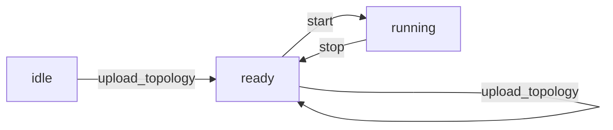

# Client Protocol

NEST server and clients talk over a single WebSocket connection carrying JSON
messages in both directions. This page documents that protocol: how a client
drives a simulation, what the server reports back, and what happens in every
failure case.

## Overview

A NEST server hosts exactly one simulation, and every connected client acts on
that same instance: there is no session, no scoping and no authentication. Any
number of clients may be connected at the same time (e.g. a scenario runner,
the web app, a debugging terminal) and all of them receive the same stream of
updates, whichever of them sent the action that produced them.

Two kinds of messages cross the wire:

- **Actions** (client → server): start and stop the simulation, upload a
  topology, send a command to a component, set an environment variable.
- **Updates** (server → client): status changes, and the events, logs and
  errors produced by running components.

The web app served by the NEST server speaks this exact protocol, and so does
the [Python client](https://github.com/CHESS-mission/nest-python-client), which
wraps it in a scenario DSL.

## Connecting

The server listens on the address given by `--listen` (or `-l`, or the
`NEST_SOCKET_ADDR` environment variable), `localhost:3000` by default. The
WebSocket endpoint is the `/ws` path of that address:

```
ws://localhost:3000/ws
```

Messages must be UTF-8 **text** frames holding one JSON object each; other frame
kinds (binary, fragment) are ignored. Both directions use the same connection,
which stays open until either side closes it. Nothing needs to be negotiated
first: the server immediately sends one `status` update describing its current
state, which is the only way to learn whether a topology is already loaded and
whether the simulation is running.

```python
import json
from websocket import create_connection  # pip install websocket-client

ws = create_connection("ws://localhost:3000/ws")
print(json.loads(ws.recv()))  # {"type": "status", "state": "idle"}
```

## Lifecycle

A server moves between three states, and every state transition is advertised
to all connected clients via a `status` update:



Each state accepts only some of the actions; the rest are rejected, as
summarized below.

| Action              | From `idle`                     | From `ready`        | From `running`            |
|---------------------|----------------------------------|---------------------|---------------------------|
| `start`             | rejected, connection dropped     | starts simulation   | ignored                   |
| `stop`              | ignored                          | ignored             | stops, back to `ready`    |
| `upload_topology`   | loads, goes to `ready`           | reloads, stays      | rejected                  |
| `command`           | ignored                          | ignored             | delivered to component    |
| `set_env`           | ignored                          | ignored             | applied to variable       |

| State     | Meaning                                                              |
|-----------|----------------------------------------------------------------------|
| `idle`    | No topology loaded; nothing to run                                    |
| `ready`   | A topology is loaded and validated; its components are not running    |
| `running` | Components are started, wired and exchanging messages                 |

`stop` returns to `ready` rather than to `idle`: the topology is rebuilt from the
same specification, so a simulation can be started again after a stop, and a
running simulation can be replaced by uploading a new topology only after
stopping it.

## Example

Here is a simple self-contained client that loads a topology, runs it for a few
seconds while ramping an environment variable, and prints what comes back.

```python title="client.py"
import json, time
from websocket import create_connection

with open("topology.yaml") as f:
    topology = f.read()

ws = create_connection("ws://localhost:3000/ws")
ws.settimeout(1.0)

def drain():
    """Print every update the server sent since the last call."""
    while True:
        try:
            update = json.loads(ws.recv())
        except Exception: # timeout, nothing left to read
            return
        kind = update["type"]
        if kind == "status":
            print("status:", update["state"])
        elif kind == "log":
            print(f"  [{update['component']}] {update['message']}")
        elif kind == "event":
            print(f"  event {update['event']} = {update['data']}")
        elif kind == "error":
            print(f"  ERROR [{update['component']}] {update['message']}")

ws.send(json.dumps({"action": "upload_topology", "topology_yaml": topology}))
drain() # status: ready, or the previous status if loading failed

ws.send(json.dumps({"action": "start"}))
drain() # status: running, first logs

# Warm up, then ramp the temperature from 20 to 90 over 5 s
time.sleep(5)
ws.send(json.dumps({"action": "set_env", "variable": "temperature",
                    "type": "float", "value": 20.0}))
ws.send(json.dumps({"action": "set_env", "variable": "temperature",
                    "type": "float", "value": 90.0, "lerp_over_s": 5}))

for _ in range(10):
    time.sleep(1)
    drain()

ws.send(json.dumps({"action": "command", "component": "TEMP_SENSOR",
                    "command": "simulate_failure", "arguments": "true"}))
time.sleep(2)
drain()

ws.send(json.dumps({"action": "stop"}))
drain() # status: ready
ws.close()
```

## Actions

Every action is a JSON object whose `action` tag selects the operation. All
fields listed as required must be present, with the exact type shown, or the
whole message is discarded.

| Action            | Fields                                                  | Requires        |
|-------------------|---------------------------------------------------------|-----------------|
| `start`           | none                                                    | `ready`         |
| `stop`            | none                                                    | `running`       |
| `upload_topology` | `topology_yaml` (string)                                | `idle`, `ready` |
| `command`         | `component` (string), `command` (string), `arguments` (any JSON) | `running` |
| `set_env`         | `variable` (string), `type` (string), `value` (see below), `lerp_over_s` (number, optional) | `running` |

### `start`

```json
{"action": "start"}
```

Spawns every component of the loaded topology, each on its own thread. Emits a
`running` status update, then the components' own logs and events.

### `stop`

```json
{"action": "stop"}
```

Requests each component to stop, and waits for it. QEMU components shut their
virtual machine down, WebAssembly components run their finalization. Emits a
`status` update with the resulting state (`ready`). Sending it in any other state
emits the current status and changes nothing.

### `upload_topology`

```json
{"action": "upload_topology", "topology_yaml": "components:\n  - name: CPU\n    ..."}
```

The YAML text of a complete topology, exactly as it would appear in a file. On
success, the server emits a `ready` status update whose payload is the parsed
topology, which is also how a client confirms the upload went through and sees
how it was interpreted.

### `command`

```json
{"action": "command", "component": "TEMP_SENSOR", "command": "simulate_failure",
 "arguments": "true"}
```

Sends a named command to one component, with a free-form JSON payload whose
meaning is defined by that component; see each component's reference page for
the commands it supports (`arguments` is required even when the command takes
none, and `null` is the natural value then). Commands are queued by the
component and handled asynchronously: the server does not wait for, or report,
their outcome. A component that does not know a command logs an error, or emits
nothing, depending on its implementation.

### `set_env`

```json
{"action": "set_env", "variable": "temperature", "type": "float", "value": 20.0}
{"action": "set_env", "variable": "sun_vector", "type": "vec3",
 "value": {"x": 0.5, "y": -0.5, "z": 0.7}, "lerp_over_s": 30}
```

Writes an environment variable, which components observe through their
environment ports. The `type` tag must match the type declared for the variable
in the topology; `value` is then encoded per type:

| `type`       | `value`                                                     |
|--------------|--------------------------------------------------------------|
| `int`        | integer, e.g. `42`                                            |
| `float`      | number, e.g. `20.5`                                           |
| `bool`       | `true` or `false`                                             |
| `vec2`       | `{"x": .., "y": ..}`                                          |
| `vec3`       | `{"x": .., "y": .., "z": ..}`                                 |
| `quaternion` | `{"w": .., "x": .., "y": .., "z": ..}`, not necessarily normalized |
| `tensor`     | `{"shape": [2, 3], "data": [ ... ]}`, row-major               |

With `lerp_over_s`, the variable moves from its current value to the new one
over the given number of seconds instead of jumping; components reading it in
the meantime observe the interpolated value. Interpolation is linear for floats
and vectors, shortest-arc for quaternions, element-wise for tensors of matching
shape, and a step at the end of the interval for integers and booleans.

## Updates

Every update is a JSON object tagged by `type`.

| Type      | Fields                                                        | Emitted when                                    |
|-----------|---------------------------------------------------------------|-------------------------------------------------|
| `status`  | `state`, and `topology` for `ready` and `running`             | On connect, and after any state change          |
| `event`   | `timestamp`, `component`, `event`, `data`                     | A component emits an event                      |
| `log`     | `timestamp`, `level`, `component`, `message`                  | A component logs                                |
| `error`   | `timestamp`, `component`, `message`                           | A component fails in a way it cannot recover from |

### `status`

```json
{"type": "status", "state": "running", "topology": {
  "environment": [{"variable": "temperature", "type": "float"}],
  "components": [
    {"name": "AlpineVM", "type": "qemu",
     "ports": [{"port": "gpio0", "type": "bool"}, {"port": "i2c", "type": "i2c"}]},
    {"name": "TEMP_SENSOR", "type": "wasm",
     "ports": [{"port": "i2c", "type": "i2c"}]}
  ],
  "wires": [
    {"endpoints": [{"component": "AlpineVM", "port": "i2c"},
                   {"component": "TEMP_SENSOR", "port": "i2c"}]}
  ]
}}
```

`state` is one of `idle`, `ready`, `running`; `idle` carries no `topology`. The
payload is the *parsed* topology: component and port names and types, and wire
endpoints. It deliberately leaves out each component's `config` and its
environment ports, so it is a summary of the system, not a round-trippable copy
of the source YAML.

### `event`

```json
{"type": "event", "timestamp": 3.0415, "component": "LED",
 "event": "changed_state", "data": "on"}
```

Machine-parsable output intended for scenario validation. `event` and `data` are
defined by the component: `data` is any JSON value, `event` a name. Events
cross the boundary from a component to clients without being interpreted, so a
device emitting a JSON text and one emitting a structured object look the same
from here.

### `log`

```json
{"type": "log", "timestamp": 0.0374, "level": "info", "component": "TEMP_SENSOR",
 "message": "Initialized at I2C address 0x4A"}
```

Human-readable output, for monitoring and debugging. `level` is one of `info`,
`warning`, `error`. Logs are not a validation interface: components use them for
whatever they find worth saying, including failures that never surface as an
event or an error update.

### `error`

```json
{"type": "error", "timestamp": 0.0195, "component": "LED",
 "message": "failed to find function export"}
```

The last words of a component whose thread returned an error, typically because
it could not be initialized.

### Timestamps

`timestamp` in events, logs and errors is a floating-point number of seconds
since the simulation started, i.e. since the `start` action that brought the
server to `running`, not since the client connected and not since any
wall-clock epoch. Timestamps of updates from different components are
comparable, but their ordering only reflects the order in which components
produced them.
