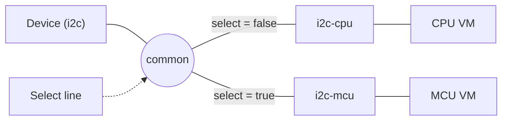

# Multiplexer Component

A NEST component routing the messages of one *common* port to one of two
*channel* ports, according to a digital select signal, to model hardware bus
multiplexers and switches.

## Overview

Real systems sometimes share a device or a bus between several paths (e.g., one
sensor reachable from two processors). The multiplexer component (type `mux`)
models those switches, without having to emulate a dedicated mux chip as a
device.

A mux instance groups ports into multiplexed sets, each made of one common port
and exactly two channels, and reacts to messages received on its `select` port:

- messages sent to the **common** port are forwarded to the selected channel
  only;
- messages sent to a **channel** are forwarded to the common port only if that
  channel is currently selected, and are otherwise dropped;
- `select` being `false` selects channel 0 (the first one listed), `true`
  selects channel 1, and the default at start-up is `false`.

For example, with one I2C device connected to two VMs:



The component is entirely type-agnostic: a group can be of any
[supported port type](../../learn/concepts/topology.md#system-ports) (`bool`,
`int`, `float`, `bytes`, `text` or `i2c`), as long as the common port and both
channels share the same type. It is also protocol-agnostic: it simply forwards
whatever it receives, which requires care with request/reply protocols such as
I2C (see [Limitations](#limitations)).

## Example

One I2C temperature sensor shared between two virtual machines, selected by a
GPIO line of the primary CPU. Releasing the line (select `false`) gives the
sensor to the CPU, driving it high gives it to the MCU; whichever VM is not
selected sees its transactions time out, as they would on real hardware.

```yaml title="topology.yaml"
environment_variables:
  - name: temperature
    type: float

components:
  - name: CPU
    type: qemu
    config:
      arch: x86_64
      mem_mb: 512
      options:
        - option: drive
          value: file=path/to/alpine.qcow2
        - option: nographic
      ngpio: 8
      gpio_names:
        0: mux-select
      i2c_timeout_ms: 10
    ports: # (1)!
      system:
        - name: gpio0
          type: bool
        - name: i2c
          type: i2c

  - name: MCU
    type: qemu
    config:
      arch: x86_64
      mem_mb: 512
      options:
        - option: drive
          value: file=path/to/alpine-vm2.qcow2
        - option: nographic
      i2c_timeout_ms: 10
    ports:
      system:
        - name: i2c
          type: i2c

  - name: BUS_MUX
    type: mux
    config:
      multiplexed_ports:
        - common: i2c # (2)!
          channels: # (3)!
            - i2c-cpu
            - i2c-mcu
    ports:
      system:
        - name: select # (4)!
          type: bool
        - name: i2c
          type: i2c
        - name: i2c-cpu
          type: i2c
        - name: i2c-mcu
          type: i2c

  - name: TEMP_SENSOR
    type: wasm
    config:
      module: path/to/temp_sensor.wasm
      options:
        - ["i2c_address", "0x4A"]
    ports:
      system:
        - name: i2c
          type: i2c
      environment:
        - name: temperature
          variable: temperature
          type: float

wires:
  -
    - component: CPU # (5)!
      port: i2c
    - component: BUS_MUX
      port: i2c-cpu
  -
    - component: MCU
      port: i2c
    - component: BUS_MUX
      port: i2c-mcu
  -
    - component: BUS_MUX # (6)!
      port: i2c
    - component: TEMP_SENSOR
      port: i2c
  -
    - component: CPU # (7)!
      port: gpio0
    - component: BUS_MUX
      port: select
```

1. Both VMs declare an I2C bus; only the CPU needs a GPIO line to drive the
   select signal.
2. The device side of the switch, connected to the shared device.
3. Exactly two channels, ordered: the first is selected when `select` is
   `false`, the second when it is `true`.
4. The select port is optional. Without it, the mux is statically latched to
   channel 0.
5. Channel 0 carries the CPU's bus.
6. The common port connects to the switched device.
7. Driving `mux-select` high in the CPU (`gpioset -t 0 mux-select=1`) moves the
   sensor to the MCU.

## Reference

### Configuration

| Name                | Type | Default      | Description                          |
|---------------------|------|--------------|--------------------------------------|
| `multiplexed_ports` | list | `[]`         | List of multiplexed port groups      |

Each group is a mapping of:

| Name       | Type   | Description                                             |
|------------|--------|---------------------------------------------------------|
| `common`   | string | Name of the port shared by the two channels             |
| `channels` | list   | Names of exactly two channel ports, in selection order  |

Groups can mix freely, and each can use a different port type:

```yaml
config:
  multiplexed_ports:
    - common: i2c
      channels: [i2c-cpu, i2c-mcu]
    - common: irq
      channels: [irq-cpu, irq-mcu]
```

Groups are independent in terms of traffic but share the instance's single
`select` port: all groups of a mux switch at the same time, which is what makes
it possible to model multi-pole switches (for instance a full I2C bus and its
interrupt line, switched together).

!!! warning

    The configuration is validated when the topology is loaded, together with
    the declared ports. The following make loading fail:

    - a group with a number of channels other than two;
    - a `common` or channel port of a group which is not declared as a system
      port of the component;
    - a common port and a channel port of different types;
    - or any declared port that is neither `select` nor part of a group.

### System ports

| Name                        | Type              | Description                                                        |
|-----------------------------|-------------------|--------------------------------------------------------------------|
| `select`                    | bool              | Channel select line; optional, defaults to `false` (channel 0)    |
| *the names given in groups* | any, one per port | The common and channel ports of every group, all matching in type |

Apart from `select`, every port declared by the component must appear in a
group, otherwise loading fails. Messages received on the non-selected channel
are dropped silently, in both directions.

### Environment ports

This component has no environment ports.

### Commands

This component supports no command; sending one logs `Mux does not support
simulator command: <name>`. The select input is a port like any other, so a mux
is driven from within the simulated system (a VM GPIO line, a device output)
rather than from a scenario.

### Events

This component doesn't emit events.

## Limitations

- **Two channels per group, and one select signal per instance**: N-channel
  muxes and per-group selection are not supported yet.
- **Switching is not atomic with respect to traffic in flight**: selection
  changes as soon as the select message is processed, which can split a
  transaction in progress. With I2C in particular, a reply coming back on a
  channel that is no longer selected is dropped, and the master times out.
